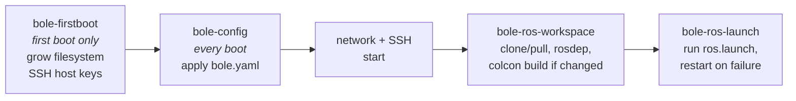

# bole

A flashable **Ubuntu Server 26.04 + ROS 2 Lyrical** image for **Raspberry Pi 4 and Raspberry Pi 5**, built with Ansible and Packer and published automatically by GitHub Actions.

Flash it, put your WiFi and ROS project in one file on the SD card, power on. The Pi joins your network, clones and builds your ROS 2 workspace, and starts your launch file. To change the WiFi, password or project later, edit that file and reboot. No rebuild needed.

- One image for Pi 4 and Pi 5 (arm64)
- ROS 2 `ros-base` plus `colcon`, `rosdep` and `vcstool`
- Runtime settings in **`bole.yaml`** on the boot partition, re-applied on every boot
- Your ROS project is cloned, built and launched at boot, and restarted if it crashes
- Reachable as `<hostname>.local` (mDNS)
- Every Pi gets its own SSH host keys and machine-id, and the filesystem grows to fill the card
- No secrets in the image: credentials only ever live on your SD card

## Contents

- [Quick start](#quick-start)
- [Where each setting lives](#where-each-setting-lives)
- [bole.yaml reference](#boleyaml-reference)
- [The `bole` command](#the-bole-command)
- [What happens at boot](#what-happens-at-boot)
- [Building the image yourself](#building-the-image-yourself)
- [Releases and CI](#releases-and-ci)
- [Testing](#testing)
- [Troubleshooting](#troubleshooting)
- [Security notes](#security-notes)
- [Repository layout](#repository-layout)
- [License](#license)

## Quick start

### 1. Get the image

- **Release:** download `bole-<version>-pi4-pi5-ubuntu-26.04.1-lyrical-arm64.img.xz` from the repository's **Releases** page, or
- **Latest build:** open **Actions → Build image**, pick a run on `main` and download the artifact (kept for 14 days), or
- **Build it yourself:** see [Building the image yourself](#building-the-image-yourself).

Check the download:

```bash
sha256sum -c bole-*.img.xz.sha256
```

### 2. Flash it

With **Raspberry Pi Imager**, choose *Choose OS → Use custom* and select the `.img.xz`.
**Skip Imager's "OS customisation"** (user, WiFi, SSH): it writes cloud-init files, which bole doesn't use. `bole.yaml` replaces them.

Or from a Linux shell (replace `/dev/sdX` with your card; check it with `lsblk` first):

```bash
xz -dc bole-*.img.xz | sudo dd of=/dev/sdX bs=4M conv=fsync status=progress
```

### 3. Edit `bole.yaml`

Re-insert the card. A partition called **`system-boot`** appears (readable on Linux, Windows and macOS). Open **`bole.yaml`** in it and set at least:

```yaml
user:
  password: "something-better-than-bole"

wifi:
  country: "RS"
  networks:
    - ssid: "Home WiFi"
      password: "wifi-password"

ros:
  repo: "https://github.com/you/your_robot.git"
  launch: "ros2 launch your_robot bringup.launch.py"
```

Every option is explained in the file itself and in the [reference](#boleyaml-reference) below.

### 4. Boot and log in

Put the card in the Pi and power it on. The first boot takes longer: it grows the filesystem, generates SSH keys and builds your ROS workspace.

```bash
ssh bole@bole.local        # default password "bole" unless you changed it in bole.yaml
bole status                # state of the bole services
bole logs                  # follow the config / build / launch logs
```

> **Pi 5 or older Pi 4 boards:** if the Pi doesn't boot at all, update its bootloader EEPROM first (Raspberry Pi Imager → *Misc utility images → Bootloader*).

## Where each setting lives

| What you want to change | File | Takes effect |
|---|---|---|
| WiFi networks and country, hostname, password, SSH keys, password login, timezone, static IP | `bole.yaml` on the SD card (`/boot/firmware/bole.yaml` on the Pi) | next boot, or right away with `sudo bole apply` |
| ROS project: repo, branch, workspace, build args, launch command, `ROS_DOMAIN_ID`, RMW, extra env vars, deploy key | `bole.yaml` (`ros:` section) | next boot, or `sudo bole apply` |
| ROS distro, package set (`ros-base`/`desktop`), extra apt packages | [`ansible/group_vars/all.yml`](ansible/group_vars/all.yml) | image build |
| Default user and password hash, locale, default timezone/hostname/WiFi country, snapd removal, unattended-upgrades | [`ansible/group_vars/all.yml`](ansible/group_vars/all.yml) | image build |
| Pi hardware: I2C, SPI, UART, extra `config.txt` lines, target model | [`ansible/group_vars/all.yml`](ansible/group_vars/all.yml) (`pi_*`) | image build |
| Base Ubuntu image (URL, checksum, version), image size, version label | [`packer/variables.pkr.hcl`](packer/variables.pkr.hcl) | image build |
| When CI builds and releases | [`.github/workflows/build-image.yml`](.github/workflows/build-image.yml) | — |

Rule of thumb: if it differs between robots or might change after flashing, it belongs in `bole.yaml`. Otherwise it's a build-time setting.

## bole.yaml reference

The shipped file ([template](ansible/roles/bootconfig/templates/bole.yaml.j2)) is commented. Put text values in `"double quotes"`, especially passwords and SSIDs (an unquoted `12345678` is read as a number and rejected). Unknown keys are rejected too, so typos don't go unnoticed.

| Key | Default | Meaning |
|---|---|---|
| `hostname` | `bole` | Network name; the Pi answers as `<hostname>.local` |
| `timezone` | `Europe/Belgrade` | Any name from `timedatectl list-timezones` |
| `user.password` | — | New login password (plain text; anyone with the card can read it) |
| `user.password_hash` | — | Better: a hash from `openssl passwd -6`. Use only one of the two |
| `user.ssh_authorized_keys` | `[]` | Public keys allowed to log in. Keys you add on the Pi yourself are kept |
| `ssh.password_auth` | `true` | Set `false` once key login works |
| `wifi.country` | `RS` | Two-letter regulatory domain; decides which channels may be used |
| `wifi.networks` | `[]` | List of `{ssid, password, hidden}`; connects to whichever is in range. Omit `password` for open networks |
| `wifi.interface` | `wlan0` | WiFi interface name |
| `ethernet.enabled` / `ethernet.dhcp` | `true` / `true` | Set `dhcp: false` plus `address`, `gateway`, `dns` for a static IP |
| `ros.repo` | `""` | Git URL of your ROS 2 package(s); cloned into `<workspace>/src`. Empty = do nothing |
| `ros.branch` | `""` | Branch to use; empty = the repo's default branch |
| `ros.workspace` | `~/ros2_ws` | colcon workspace |
| `ros.update_on_boot` | `true` | Pull on every boot (fast-forward only) and rebuild if there are new commits |
| `ros.build_args` | `--symlink-install` | Extra `colcon build` arguments, e.g. `--parallel-workers 2` on a 2 GB Pi |
| `ros.launch` | `""` | Command started after the build and restarted on failure, e.g. `ros2 launch pkg bringup.launch.py` |
| `ros.domain_id` | `0` | `ROS_DOMAIN_ID` |
| `ros.rmw` | `""` | `RMW_IMPLEMENTATION`, e.g. `rmw_cyclonedds_cpp` (install it via `ros_extra_packages`) |
| `ros.deploy_key` | `""` | File name of an SSH private key next to `bole.yaml`, for private repos |
| `ros.environment` | `{}` | Extra environment variables for the shell and the launch service |

### Private repositories

1. Create a key pair: `ssh-keygen -t ed25519 -f deploy_key -N ""`.
2. Add `deploy_key.pub` as a read-only **deploy key** in your repository settings.
3. Copy `deploy_key` (the private half) to the `system-boot` partition and set:

   ```yaml
   ros:
     repo: "git@github.com:you/private_robot.git"
     deploy_key: "deploy_key"
   ```

bole copies the key to `~/.ssh/bole_deploy_key` with the right permissions (the FAT partition can't store them).

## The `bole` command

| Command | What it does |
|---|---|
| `bole status` | Status of all bole services |
| `bole logs` | Follow the logs of config, build and launch |
| `bole check` | Validate `bole.yaml` without changing anything |
| `sudo bole apply` | Apply `bole.yaml` now (network, SSH, password...) and restart the ROS services if ROS settings changed |
| `sudo bole edit` | Edit `bole.yaml`, validate it, offer to apply |
| `sudo bole rebuild` | Force a fresh pull, `rosdep install` and `colcon build`, then restart the launch |
| `sudo bole restart` | Restart the launch command |

In a shell, ROS and your built workspace are already sourced (via `~/.bashrc`), with the domain ID and RMW from `bole.yaml`.

## What happens at boot



- **bole-config** runs before networking starts. It writes the netplan, hostname, timezone, password, SSH and `/etc/bole/ros.env` from `bole.yaml`. If `bole.yaml` is invalid, nothing is changed and the reason is written to **`bole-error.txt`** on the boot partition, so you can read it from your PC.
- **bole-ros-workspace** rebuilds only when the repo, branch, build args or commit changed. It never discards local commits or edits made on the robot (fast-forward only). If you switch `ros.repo`, the old clone is moved to `<workspace>/.bole-old/`, not deleted.
- **cloud-init is disabled.** `bole.yaml` replaces it.

## Building the image yourself

Most people don't need this: CI builds the image on every push. Build locally to test changes or custom variants.

### Requirements

- Linux with `sudo` or `doas` (loop devices and chroot need root; `build.sh` picks whichever exists, or set `BOLE_SUDO=...`)
- [Packer](https://developer.hashicorp.com/packer/install) ≥ 1.11, `ansible-core`, `python3`, `curl`, `xz`, `sfdisk`, `parted`, `e2fsprogs`, `qemu-img`, `kpartx`
- On **x86_64** hosts, aarch64 user-mode emulation (builds are several times slower than on arm64):

```bash
# Fedora
sudo dnf install ansible-core xz util-linux parted e2fsprogs qemu-img kpartx qemu-user-static-aarch64   # + Packer from HashiCorp's dnf repo
# Debian / Ubuntu
sudo apt install ansible-core xz-utils fdisk parted e2fsprogs qemu-utils kpartx qemu-user-static   # + Packer from HashiCorp's apt repo
```

### Build

```bash
./packer/build.sh
# -> output/bole-<git describe>-pi4-pi5-ubuntu-26.04.1-lyrical-arm64.img.xz (+ .sha256)
```

`build.sh` installs the Ansible collections and the
[packer-plugin-builder-arm](https://github.com/mkaczanowski/packer-plugin-builder-arm) plugin locally (`ansible/collections/`, `.packer/`), then runs `packer build` as root (via sudo or doas).
Any extra arguments are passed to Packer:

```bash
# Override any simple group_vars value (edit group_vars/all.yml for lists)
./packer/build.sh -var 'ansible_extra_args=-e ros_package=desktop -e base_remove_snapd=false'

# Scope the config.txt settings to one model
./packer/build.sh -var pi_model=pi5

# Ubuntu 24.04 + ROS 2 Jazzy: take the image URL and SHA256 from
# https://cdimage.ubuntu.com/releases/24.04/release/ (check the partition
# start sectors in packer/bole.pkr.hcl still match with `sfdisk -d`)
./packer/build.sh -var ubuntu_version=24.04.x -var ubuntu_image_url=... -var ubuntu_image_sha256=... -var ros_distro=jazzy
```

The ROS distro must have packages for the Ubuntu release (26.04 → `lyrical`; 24.04 → `jazzy`, `kilted`). The playbook stops with a clear error otherwise.

### Updating a running Pi without reflashing

The playbook also works over SSH against a running Pi:

```bash
cp ansible/inventory/pi.example.yml ansible/inventory/pi.yml   # set ansible_host
cd ansible && ansible-galaxy collection install -r requirements.yml
ansible-playbook -i inventory/pi.yml site.yml --ask-pass --ask-become-pass
```

## Releases and CI

- **Lint and test** ([`lint.yml`](.github/workflows/lint.yml)) runs on every push and pull request: yamllint, ansible-lint, shellcheck, pytest, `packer validate`.
- **Build image** ([`build-image.yml`](.github/workflows/build-image.yml)) runs on pushes to `main` that touch the image (docs-only changes are skipped), on tags and manually. It builds on GitHub's native arm64 runners and uploads the image as an artifact.
- **Releases:** push a version tag and the image is attached to a GitHub Release automatically:

  ```bash
  git tag v1.0.0
  git push origin v1.0.0
  ```

## Testing

```bash
# Static checks and unit tests (the same as CI)
pip install ansible-core ansible-lint yamllint pytest pyyaml jinja2
ansible-galaxy collection install -r ansible/requirements.yml
yamllint --strict .
(cd ansible && ansible-lint)
shellcheck packer/*.sh tests/vagrant/*.sh ansible/roles/bootconfig/files/bole ansible/roles/bootconfig/files/bole-firstboot
pytest tests
```

**Vagrant** runs the whole playbook in an Ubuntu 26.04 VM (libvirt) using [`tests/vagrant/bole.yaml`](tests/vagrant/bole.yaml) as the SD card config. It then builds and launches a ROS 2 demo publisher and checks that its messages arrive:

```bash
sudo dnf install vagrant vagrant-libvirt     # Fedora; or your distro's packages
vagrant up --provider=libvirt
vagrant provision                            # re-run: expect changed=0 (idempotent)
vagrant destroy -f
```

The VM is x86_64, so Pi-only parts (`config.txt`, partition growing) are skipped there. The image build's [`verify.sh`](packer/verify.sh) covers them.

## Troubleshooting

| Problem | What to check |
|---|---|
| Settings from `bole.yaml` not applied | Look for `bole-error.txt` next to `bole.yaml`; on the Pi: `bole check`, `journalctl -u bole-config -b` |
| WiFi doesn't connect | SSID and password in quotes? Correct `wifi.country`? 5 GHz channel allowed in that country? `networkctl status wlan0` |
| Can't find `bole.local` | Your PC needs mDNS (Linux: avahi/nss-mdns; Windows 10+ and macOS have it). Otherwise find the IP in your router |
| ROS project not built | `journalctl -u bole-ros-workspace -b`; `sudo bole rebuild` |
| Launch keeps restarting | `journalctl -u bole-ros-launch -b`; try the command by hand in a shell |
| Out of memory while building | Add `--parallel-workers 1` to `ros.build_args` |

## Security notes

- The image ships with user **`bole`** / password **`bole`** and password SSH login enabled. **Change the password** (`user.password_hash`) and preferably switch to SSH keys (`ssh_authorized_keys` plus `password_auth: false`) before putting the robot on a shared network.
- `bole.yaml` and a deploy key on the boot partition are readable by anyone holding the SD card. Use `password_hash` instead of `password`, and read-only deploy keys.
- Root login over SSH is disabled and the root password is locked.

## Repository layout

```
ansible/                 Ansible playbook (site.yml), build-time settings (group_vars/all.yml) and roles:
  roles/base             packages, locale, timezone, Pi config.txt
  roles/users            default user, hardware groups (gpio, i2c, spi)
  roles/ssh              sshd settings, host keys at first start
  roles/network          WiFi tooling, mDNS, hostname
  roles/ros              ROS 2 apt repo, packages, rosdep, shell environment
  roles/bootconfig       bole.yaml template, bole-apply-config, first-boot service, bole command
  roles/ros_workspace    clone/build/launch services
  roles/cleanup          image-only cleanup
packer/                  Packer template, variables, plugin installer, verify.sh, build.sh
tests/                   pytest unit tests; Vagrant test config and checks
Vagrantfile              VM test environment
```

Contributor and AI-agent conventions are in [AGENTS.md](AGENTS.md).

## License

[GNU General Public License v3.0](LICENSE)
